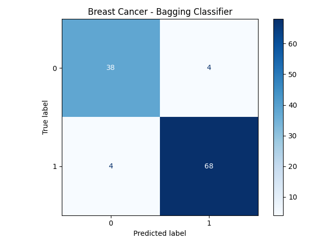

# Breast Cancer Classification using Bagging

## Project Overview
This project uses a **Bagging Classifier with Decision Trees** to classify breast cancer data. The model is implemented using Scikit-learn and a Machine Learning Pipeline.

The goal is to predict the target class based on features extracted from breast cancer diagnostic data.

## Dataset
- **Dataset:** `breast_cancer.csv`
- **Total Records:** 569
- **Total Columns:** 31
- **Input Features:** 30
- **Target Column:** `target`

## Technologies Used
- Python
- Pandas
- Scikit-learn
- Matplotlib
- Machine Learning Pipeline
- Bagging Classifier
- Decision Tree Classifier

## Project Workflow
1. Load the dataset using Pandas.
2. Separate input features and target labels.
3. Split the dataset into training and testing sets.
4. Create a Pipeline with a Bagging Classifier.
5. Train the model using Decision Trees.
6. Predict target values for the test dataset.
7. Evaluate the model using accuracy, classification report, and confusion matrix.
8. Visualize and save the confusion matrix.

## Model Details
- **Algorithm:** Bagging Classifier
- **Base Estimator:** Decision Tree Classifier
- **Number of Estimators:** 10
- **Test Size:** 20%
- **Random State:** 42
- **Stratified Train-Test Split:** Yes

## Results

The model achieved an accuracy of **92.98%** on the test dataset.

| Metric | Class 0 | Class 1 |
|---|---:|---:|
| Precision | 0.90 | 0.94 |
| Recall | 0.90 | 0.94 |
| F1-Score | 0.90 | 0.94 |
| Support | 42 | 72 |

- **Accuracy:** 92.98%
- **Test Samples:** 114
- **Correct Predictions:** 106
- **Incorrect Predictions:** 8

### Confusion Matrix

```text
[[38  4]
 [ 4 68]]
```

The confusion matrix shows:
- 38 Class 0 samples were correctly classified.
- 4 Class 0 samples were incorrectly classified as Class 1.
- 4 Class 1 samples were incorrectly classified as Class 0.
- 68 Class 1 samples were correctly classified.

### Confusion Matrix Visualization

The program saves the confusion matrix plot as `confusion_matrix.png`.



## Installation

Install the required Python libraries:

```bash
pip install pandas scikit-learn matplotlib
```

## How to Run

Keep the dataset and Python script in the same project folder.

Run the following command:

```bash
python BaggingClassificationBreastCancer.py
```

## Conclusion

The Bagging Classifier achieved **92.98% accuracy** on the test dataset. The model combines predictions from multiple Decision Trees to improve classification performance.

This project demonstrates ensemble learning, machine learning pipelines, model evaluation, and data visualization using Python.

**Note:** This project is for educational purposes and is not intended for clinical diagnosis or medical decision-making.
